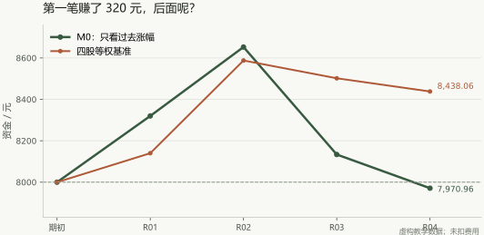

# 第 2 章｜多期成绩、假设与证据

你已经会：算收益、算基准、看一期结果。这一章只问：连续几期成绩，能不能说明规则有效？

你没有改 M0，继续按过去五日涨幅挑两只。第二期仍然选中 A、C。

结果又赚了 4%。你刚想说“连续两次”，小林把另一列推到面前：这一期四只股票的平均收益是 5.50%。

**今天先弄懂一件小事：赚了又亏，钱不一定回到原点。** 你可以先拿 100 元做例子，不需要理解任何统计词汇。

## 1. 绝对收益与相对表现

第二期结果如下。先只用前一列的分数选股，再看右边的答案：

| 股票 | 当时已知的过去五日涨幅 | 随后指定区间收益 |
|---|---:|---:|
| A | 6% | 3% |
| B | 2% | 8% |
| C | 5% | 5% |
| D | 1% | 6% |

A、C 的平均是 4%；四只股票平均是 5.50%。这一次，你的选择比对照低了 1.50 个百分点。

第一期的 4% 和第二期的 4% 一样大，它们对选股能力提供的消息却不同。第二期行情里，不挑选的对照表现更好。

你没有把第二次盈利擦掉，只在旁边补了一句：“盈利，但本期跑输对照。”

### 为什么 +10% 再 -10% 不是打平？

第一天手里有 100 元，上涨 10%，变成 **110 元**。第二天从 110 元再跌 10%，跌掉的是 11 元，所以最后是 **99 元**。

```text
第 1 天：100 × 1.10 = 110
第 2 天：110 × 0.90 = 99
最终：少了 1 元，累计收益 -1%
```

这就是**复利**最简单的意思：下一期涨跌，都是在上一期剩下的钱上发生的。书里的 8,000 元经历四期后变成约 7,970.96 元，也是同一道理。

<details>
<summary>再试：100 元连续两期各涨 10%，最后是多少？</summary>

100 × 1.1 × 1.1 = **121 元**，累计赚 21%，不是 20%。第二期多赚的 1 元来自第一期新增的 10 元也参与了第二次增长。

</details>

## 2. 多期评价与复利

我们把接下来的成绩也摊开。规则都在看答案前执行；每一期结束后，资金进入下一期，暂时仍不计费用。

| 期数 | 过去分数选出的两只 | 两只未来收益 | 组合收益 | 基准收益 |
|---|---|---|---:|---:|
| R01 | A、C | 5%、3% | 4% | 1.75% |
| R02 | A、C | 3%、5% | 4% | 5.50% |
| R03 | A、C | -8%、-4% | -6% | -1% |
| R04 | B、D | -1%、-3% | -2% | -0.75% |

每期实际使用的分数保存在 `rounds.csv` 中，可以逐行核对为什么选中 A、C 或 B、D。

每一期结束后，资金全部进入下一期。下一期的收益作用在上一期剩下的钱上，所以四期收益率不能直接相加；8,000 元要逐期相乘。

先猜一下：这四个组合收益的算术平均是零，8,000 元会不会恰好回到 8,000？

<details>
<summary>展开看资金是怎样走的</summary>

```text
8,000 → 8,320 → 8,652.80 → 8,133.632 → 7,970.95936
```

每期作用于上期剩下的钱，要逐期相乘。末尾约为 7,970.96 元，比起点少 29.04 元。四只股票等权基准则约为 8,438.06 元。



</details>

你把原来只写“4%”的成绩单换成这条路径。它没有告诉我们市场规律的最终答案，却足以推翻“看完第一期就可以宣布成功”的冲动。

第 1 章写下的停止条件现在触发了：接下来的 R02、R03、R04 全部跑输基准。按事先约定，先暂停 M0，检查数据、时点和规则，而不是马上加因子。

## 3. 研究假设与事后解释

亏损以后，你很容易想到：“那我只在上涨行情里使用它。”

小林继续追问：“你在做决定时，怎样知道接下来是上涨行情？”

如果答案是看未来的结果，这个修补就把答案偷偷放回了条件。另一个可以研究的版本，是只用当时已知的市场信息定义环境，然后重新留出评价数据。

你在记录里拆开三种说法：

- **观察**：这四期里，M0 有三期没跑赢对照。
- **解释**：也许过去涨幅在某些环境里会延续，在另一些环境里会反转。
- **待检验的假设**：一个仅使用已知信息的环境条件，能否改善这种不稳定性？

解释给下一次实验提供方向。它还不是结论。

## 4. 研报阅读与复现差异

假设你读到一段报告：“按过去二十日涨幅选前五十只，每月调整，历史收益优于指数。”

现在你会先追问：到底是哪二十个交易日？当时哪些股票能入选？用哪天的价格交易？对照是哪个指数？好结果是否集中在少数年份？

这些问题来自你自己的四期经历。第一期提醒你找对照，后面三期提醒你看路径和失败时期。

报告没披露的参数，记成“未知”。复做时自行补的约定要另列，不能把补出来的设置写成作者原来就用了。

你先在[研报复现卡](../templates/paper_replication_card.md)上填三行：它研究什么、怎样计算、还缺什么。完整的统计和策略复现等后面具备工具再做。

## 5. 否定条件与后续研究

你没有把 M0 的四期记录删掉，也没有当天就调出一个最漂亮的窗口。你决定先检查两件事：输入是不是当时能看到的，评价数据是不是已经被自己用来改规则。

把这两件事查清，才能知道问题出在数据、研究设计，还是这个想法确实没得到支持。

下一章，小林会交来一张看上去更丰富的表。它多了一列公司盈利信息，也埋着一个比亏损更麻烦的问题。

## 选读｜进阶训练：不要让复利、对照和显著性互相冒充

**入门关**：四期收益率算术平均为零，但最终本金约为 7,970.96 元。其原因不是代码错，而是复利要求逐期相乘：

~~~text
最终财富 = 初始本金 × (1+r1) × (1+r2) × ... × (1+rn)
~~~

**进阶关**：报告至少有三张并列的表：逐期组合收益、同区间基准收益、净值与回撤。注意“组合收益均值”“累计收益率”“年化收益率”不能靠同一行数字替代。样本极短时，年化数字尤其容易误导。

**研究关**：复现外部研报时，把“作者明确披露”“研究者自行假设”“数据限制导致无法确认”分栏记录。即使复现结果和原文很接近，也不能由此证明你的日期、复权、交易成本和幸存者样本正确。

<details>
<summary>思考：看到 R02–R04 连续跑输后，新规则还能把这三期当最终测试吗？</summary>

不能。它们已经被用来提出或修改新规则，只能记录为探索证据。应另外预先确定新的评价期，并完整保留新旧结果。

</details>

**本章交付**：一份包含失败期的逐期净值、基准和版本备注的小报告。
