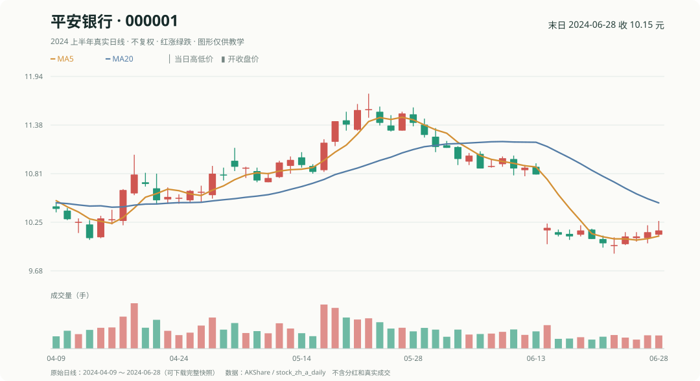

# 第 3 章｜从 K 线到数据、标签与信息时点

你已经会：股票收益率、组合和基准。**这一章先从你熟悉的 K 线开始，再把它变成电脑里的历史数据，最后区分“做决定时知道什么”和“以后才揭晓的答案”。**

小林从交易软件里抄下 A 的价格，又递来一张后来才公布的财报。你先别急着加因子：**价格是在哪天形成的？未来收益什么时候才知道？财报又是什么时候公开的？**

先把这三种时间分清，后面才不会用今天知道的答案去替过去选股。

故事里的日期是教学编号 D001、D002……，不是真实交易所日历；每六个教学交易日产生一个信号日。做决定的那一天，叫信号日。

**先记一句话：** 你在交易软件里看到的所有历史数字，不代表过去每一个时刻都知道这些数字。我们先学会看一行，再学会查时间。


## 1. 从交易软件的 K 线，到电脑里的四个价格

你已经见过日 K 线。现在先把每根 K 线当成表格的一行，暂时不谈机器学习。

你熟悉的每根日 K 线，可以拆成一张表里的四个价格；它们的英文首字母合起来就是 **OHLC（开高低收）**：

| 字段 | 大白话 | 示例（**另一个教学日**） |
|---|---|---:|
| open | 开盘价 | 10.00 元 |
| high | 当日最高价 | 10.50 元 |
| low | 当日最低价 | 9.80 元 |
| close | 收盘价 | 10.20 元 |

这一行还应该带上**股票代码、日期、成交量/成交额**。收盘后才算出的信号，不能假装已经按刚过去的同一收盘价成交；要另定次日哪个时刻尝试下单。

**看看真的 K 线长什么样：** 下图是平安银行（000001）2024 年的真实日 K 线，不是前面虚构的 A、B、C、D。红绿柱表示开盘与收盘的关系，下方是成交量。



你可以在[真实 A 股 K 线练习页](真实A股K线_入门实例.md)用 **2024-06-28** 的真实数字，逐一算实体、上下影线、MA5 和 MOM5。

### 复权到底在修什么？（第一次可以先看例子）

假设一股原本 10 元，后来每股**现金分红 1 元**，除权后交易价变为 9 元。在这个纯教学例子里，单看原始价格像跌了 10%；但持股者还有 1 元分红，**9+1=10 元**，未计税费时总财富没有凭空少掉 10%。

所以做历史走势比较，要处理分红、送转等公司行为；做真实订单回放，要记实际成交价格和分红/股份变化。不能一边用已计入分红的复权收益算盈亏，又额外再加一次现金分红。

**第一次只需记住：** 交易软件的复权 K 线用于帮助看趋势，并不等于当时真能以那个“复权价”成交。详细口径留到[金融市场与复权参考](00c_金融市场基本概念.md)查。

## 2. 同一张表，哪只股票、哪一天？

你们给表格加了一句说明：每行对应某只股票在某个信号日的状态。

| 期数 | 信号日 | 股票 | 当时已知的五日涨幅 | 事后答案 |
|---|---|---|---:|---:|
| R01 | D006 | A | 8% | 5% |
| R01 | D006 | B | -1% | 1% |
| R01 | D006 | C | 4% | 3% |
| R01 | D006 | D | 2% | -2% |

日期和股票共同定位一行，叫**主键**。同一天把四只股票放在一起，是横截面；沿着 A 的不同日期读下去，是时间序列。

这两个方向决定后面怎样分组计算。把 A 的今日价格和 B 的昨日价格相除，也能得到一个数字，但它不回答 A 涨了多少。

## 3. 当时的输入和未来的答案要分开放

A 在 R01 的标签仍然是 `10.50/10.00-1=5%`。这里起点是 D007 开盘，终点是 D011 收盘。

```text
D006 收盘后决定 → D007 开盘入场 → D011 收盘形成计划收益
```

把 5% 附在 D006 那一行，是为了以后评价 D006 的决定。模型的输入列只取当时已知的量；这列未来答案用于历史学习和评价。

如果今天只收集到 D009，D011 还没到，答案就应该空着。填零会把“还不知道”改写成“价格没变”；拿 D009 收盘代替，又换成了另一个持有区间。

## 4. 财报什么时候公布？别把晚知道的数字提前用

前面你已经把信号日、买卖日期和未来收益分开。现在再加一个**财务数据公开时间**的例子：

| 记录 | 数值 | 真正可用时刻 |
|---|---:|---|
| 此前已经公开的盈利指标 | 8% | D005 20:00 |
| 晚上公布的修订版本 | 12% | D006 20:00 |
| 本次做决定 | — | D006 16:00 |

在 D006 16:00，你能用哪个？

<details>
<summary>展开核对这次匹配</summary>

只能使用当时已经可用的 8% 版本。12% 晚了四小时。哪怕数据文件里的日期也写 D006，仍不能提前进入本次决定。

</details>

这叫**时点一致**，研究中也写成 **PIT（Point-in-Time）**。它要求重建当时能拿到的版本，而不是拿今天数据库里最完整的一列填遍过去。

你先把连接方法修正。修正后收益是升是降，都应该接受；信息早晚的错误不能靠漂亮成绩抵消。

### 一道判断题：还不知道，不等于收益为零

假设 D006 收盘后你决定买 A，计划 D007 开盘入场、D011 收盘卖出。

| 观察时刻 | D011 的卖出价格 | 能否计算这次完整收益？ |
|---|---|---|
| D006 决策时 | 还没发生 | 不能 |
| D009 收盘时 | 还没发生 | 不能 |
| D011 收盘价格确定后 | 已经知道 | 可以 |

在 D009 就给未来收益填 **0%**，意思会变成“这笔交易刚好不赚不赔”；但事实是**还不知道**。这两件事完全不同。

把这种还没出现的答案留空，在真实代码里通常记作缺失值（如 `NaN`），等标签真正形成后再计算。填零还是删行，都会改变后续学习结果，所以必须按事先规定处理。

## 5. 市场日历与缺失处理

再想一个问题：假设 C 在中间某天没有行情，删掉那一行以后，往后数五行还是原来的第五个市场交易日吗？

不一定。市场日历继续向前走，C 自己的行数却少了一条。

这次你们先按市场日历确定 D007 和 D011，再去找目标日期的价格。找不到就记缺失和原因，不另挑一个看得到的好价格。

真实项目要用适用交易所日历；这些教学编号不代表自然日或实际节假日安排。

## 6. 预测评价与成交状态

R01 的 C 有一段可计算的未来价格，但若 D007 买入时受限，它仍可能买不到。

你不能在 D006 就用这个未来限制把 C 从研究样本里删掉。先按已知条件决定它是否有资格参与研究，到了买入时再处理订单。

你们暂时把字段分成三类，不让它们互相顶替：

| 用途 | 这次要留下的东西 |
|---|---|
| 决定时的输入 | 信号日、股票、过去涨幅、已知财务版本 |
| 以后评价的答案 | 买卖价格端点、计划未来收益 |
| 以后执行的事实 | 能否买入、能否按计划卖出、实际卖出日 |

买不到以后那一半钱怎么办，第 9 章会回到这一期认真算。现在先保留事实，避免一个“清洗数据”的动作把问题擦掉。

## 7. 一张数据质量检查表

小林在表格边上写了六个问题。每接一列新数据，至少回答一遍；答不上来的，先当作“还不知道”，不要急着填进模型。

| # | 问题 | 答错会发生什么 |
|---|---|---|
| 1 | 这个数在决策时点真的可得吗？ | 用了未来才公布的值，回测虚高 |
| 2 | 后来退市或被收购的股票，还在历史样本里吗？ | 只剩活下来的公司，幸存者偏差 |
| 3 | 股票代码和公司主体在各期对得上吗？ | 改名、重组后把两家公司接成一条 |
| 4 | 拆股、分红、增发处理了吗？ | 价格跳变被当成真实收益 |
| 5 | 缺失是“没有”，还是“不知道”？ | 填零把“未知”改写成“没变化” |
| 6 | 日期用的是哪个市场日历？ | 停牌、节假日、时区错位，窗口算错 |

用故事里的数据走一遍：

- A 的盈利有两个版本，D006 16:00 只能用旧的——第 1 问。
- 假设其中一只后来退市，而历史表只保留了今天还在的股票——第 2 问。
- 如果 A 改过名，代码变了而公司主体没变，按代码连接会断——第 3 问。
- 如果 A 发生过拆股，10 元变成 5 元不是 -50% 的收益——第 4 问。
- C 某天没有行情，是停牌还是数据缺失？两种处理不同——第 5 问。
- D007 是“下一个交易日”，不是“明天”；周末和休市日不占位——第 6 问。

这张表不是让你一次全做完，而是让你在每次接新数据时，知道自己还有哪些问题没回答。

## 8. 小结：你现在能检查一张历史数据表

你没有得到一个更复杂的因子，却把表格的含义写清了：这一行属于谁、什么时间、哪些列当时可得、哪些列以后才知道。

**下一章先不急着训练模型或选择参数。** 我们只做一件直观的事：同样涨了 8% 的两条价格路径，怎样用波动、成交量等数字把差别记录下来？时间切分与最终考试的规则会等你学会计算因子后再讲。完整字段与时点连接可以第二遍查[实现参考](参考_数据标签实现与审计.md)。

## 选读｜进阶训练：用数据可用时刻建立第一道防线

**入门关**：区分三个日期：一条财务指标属于哪个报告期、它什么时候披露、策略什么时候做决定。报告期早，不代表信息早。

**进阶关：给一张历史表加字段。** 除股票、信号日和因子值外，至少增加数据版本、披露时刻、供应商可用时刻、信号截止时刻、入场日与标签结束日。历史股票池要包含当时已上市、后来可能退市的股票，不能只取今天仍在的公司。

~~~python
# 伪代码：datetime 值在同一时区下比较。
assert all(
    row["available_at"] <= row["signal_at"]
    for row in usable_feature_rows
)
~~~

上述断言是最后一步；更难的是确定 available_at 的来源是否可信。仅按季度归属期对齐的数据，不足以证明 PIT 合格。

**研究关**：分别统计“没有该指标”“当时尚未公布”“已公布但供应商未到达”“历史版本缺失”。这几种缺失来源不同，不能统统填零或向后补。训练样本是否保留、预测是否能产出、执行是否可成交也应分别标记。

**本章交付**：一个含字段定义、时区、来源、历史版本和缺失理由的数据审计表；详细步骤见[进阶实战](进阶实战_从教学数据到研究级流程.md)。
