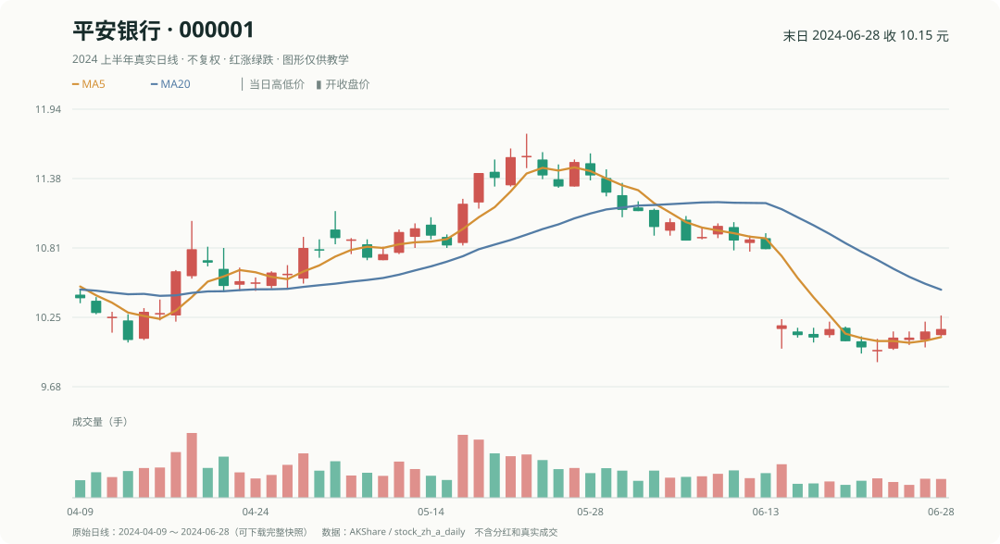
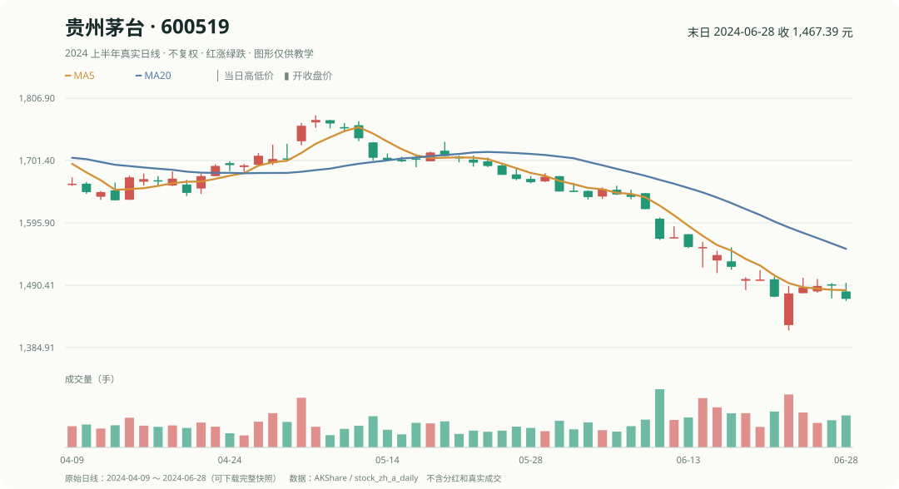
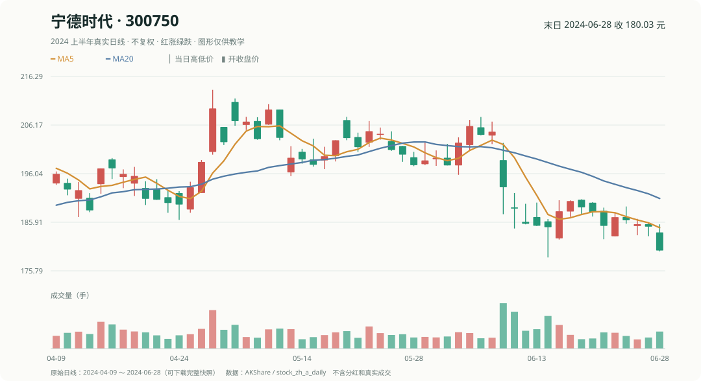

# 真实 A 股 K 线｜从看盘到计算指标

前面用 A、B、C、D 四只虚构股票练习算收益。这一课换成**真实 A 股历史 K 线**，看看你在炒股软件里见过的红绿柱、均线和成交量，怎样变成能计算的数字。

我们用 2024 年上半年的平安银行、贵州茅台和宁德时代举例。先看图，再跟着做几道题就好。

## 1. 平安银行：一根 K 线藏着四个价格

看 **2024 年 6 月 28 日**这一天：

| 开盘 | 最高 | 最低 | 收盘 |
|---:|---:|---:|---:|
| 10.10 元 | 10.26 元 | 10.09 元 | 10.15 元 |

你能从这四个数字看出什么？

- **实体是红色**：收盘 10.15 元，比开盘 10.10 元高 **0.05 元**。
- **上影线**：最高到过 10.26 元，比实体顶部高 **0.11 元**。
- **下影线**：最低到过 10.09 元，比实体底部低 **0.01 元**。
- **成交量柱**：告诉你当天交易了多少；它不是价格涨跌幅。

这里要分清：**红 K 线说明收盘高于开盘，不等于收盘一定高于昨天。**

### MA5：五个收盘价的平均数

把最近五个交易日收盘价抄出来：

| 日期 | 6 月 24 日 | 25 日 | 26 日 | 27 日 | 28 日 |
|---|---:|---:|---:|---:|---:|
| 收盘价 | 9.98 | 10.08 | 10.08 | 10.13 | 10.15 |

~~~text
MA5 = (9.98 + 10.08 + 10.08 + 10.13 + 10.15) ÷ 5
    = 10.084 元
~~~

所以图上的 **MA5 就是过去五个收盘价的平均**，不需要复杂公式。

### MOM5：过去五个交易日涨了多少？

6 月 21 日收盘 **10.00 元**，到 6 月 28 日收盘 **10.15 元**：

~~~text
五日涨幅 = 10.15 ÷ 10.00 − 1 = +1.50%
~~~

**记住区别：** MA5 用 **5 个收盘价**；五日涨幅要比较**相隔 5 个交易日的两个价格**。

试一试：假设 6 月 28 日收盘变成 10.05 元，MA5 是多少？

(9.98 + 10.08 + 10.08 + 10.13 + 10.05) ÷ 5 = **10.064 元**。这是修改数字后的练习，不是当天的真实行情。

## 2. 贵州茅台：股价高，不代表涨得更多

同样看 **2024 年 6 月 28 日**：开盘 **1480.00 元**，收盘 **1467.39 元**，所以这一天的 K 线实体是绿色。

五个交易日前的收盘价是 **1471.00 元**：

~~~text
五日涨幅 = 1467.39 ÷ 1471.00 − 1 ≈ -0.25%
~~~

而平安银行同期是 **+1.50%**。虽然两只股票每股价格差很多，但比较谁涨得多，要看**相同时间段的涨跌百分比**，不能只看一股多少钱。

想一想：绿 K 线就代表这只股票一定比昨天跌了吗？

不一定。绿实体比较的是**今天开盘和今天收盘**；通常说的日涨跌幅比较的是**昨天收盘和今天收盘**。要算后者，就得再看昨天的价格。

## 3. 宁德时代：自己算一次均线和涨跌幅

**2024 年 6 月 28 日**收盘 **180.03 元**，五个交易日前收盘 **185.16 元**。图里还有 MA5、MA20 两条均线。

练习：宁德时代过去五个交易日涨了多少？

180.03 ÷ 185.16 − 1 ≈ **-2.77%**。

当天 MA5 约为 **184.77 元**。它高于当天收盘价，只说明近期平均收盘价更高，**不表示明天一定下跌**。

## 4. 看完这三张图，应该记住什么？

- **K 线**：一根柱子告诉你当天开盘、最高、最低、收盘的关系。
- **均线 MA5、MA20**：把最近一段时间的收盘价取平均，帮助你看走势。
- **成交量**：告诉你交易是否活跃，不直接告诉你明天涨跌。
- **五日涨幅 MOM5**：把今天的收盘价和五个交易日前的收盘价相比。

**还有一个重要区别：** 这些是真实历史行情，但图中的价格没有做分红复权处理，也没有模拟买卖是否成交。**会看 K 线、会算指标，不等于已经证明它能赚钱。**

接着阅读[第 3 章：数据与信息时点](02_数据与标签.md)，理解哪些价格在做决定时已经知道；再读[第 6 章：因子计算](03a_因子表达式与算子.md)，就能把这些手算变成代码。
