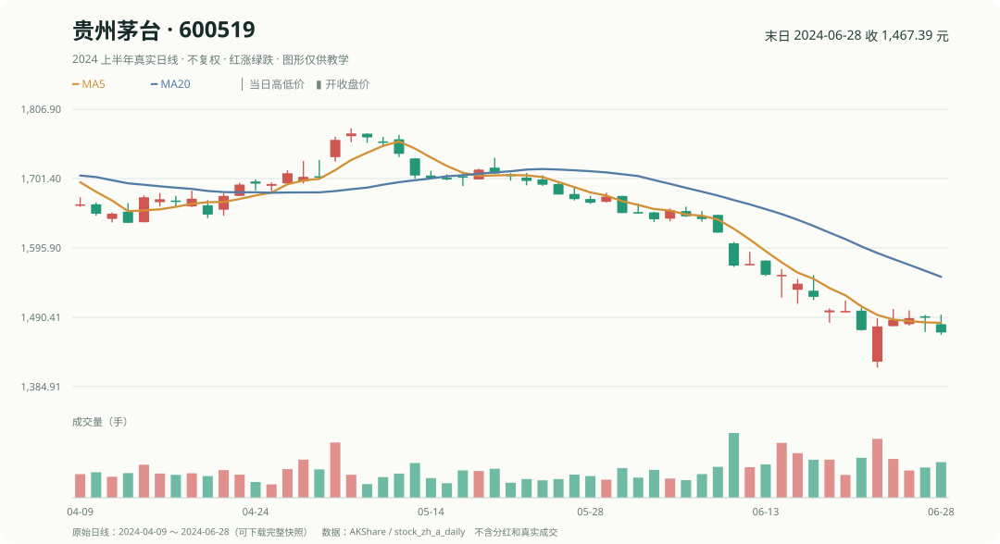
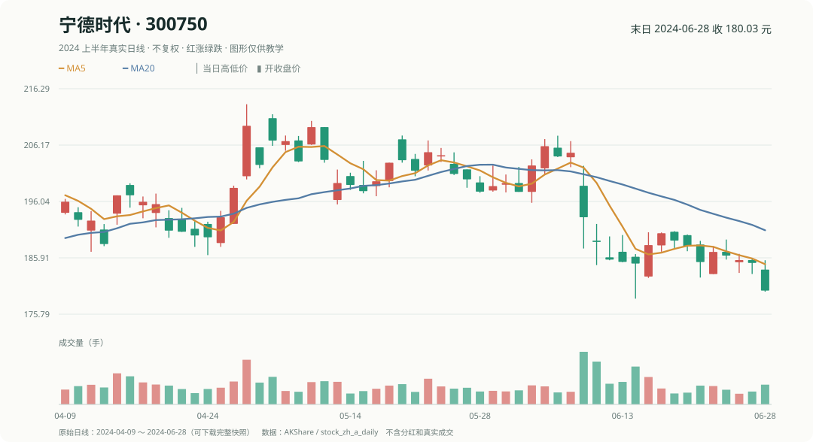

# 第 3 章｜真实 K 线怎样变成数据？什么叫“当时已知”？

之前我们把某只股票的价格直接写到表里。现在要认识一张完整的历史日线。

## 1. 一根 K 线有四个数字

**贵州茅台 2024 年 6 月 28 日**这一根 K 线确实有四个价格：

| 开盘（open） | 最高（high） | 最低（low） | 收盘（close） |
|---:|---:|---:|---:|
| **1480.00** | **1494.49** | **1464.00** | **1467.39** |

注意另一笔历史价格：**6 月 24 日开盘是 1423.00 元**，并不是 6 月 28 日的开盘价。研究一笔跨日交易时要取两个不同日期的价格，不能误把它们拼成同一根 K 线。

下面看已经核对过的**宁德时代 6 月 28 日**完整一根 K 线：

| 开盘 | 最高 | 最低 | 收盘 |
|---:|---:|---:|---:|
| 183.80 | 185.48 | 179.84 | 180.03 |

你可以算：收盘比开盘低 3.77 元，当日实体为绿色；它的最高价和最低价则决定上下影线的范围。

## 2. 两个日期，比一个股票名字更重要

用宁德时代举例：

| 时间 | 价格 | 当时能否提前知道 |
|---|---:|---|
| 6 月 21 日收盘 | 185.16 元 | 21 日收盘后已知 |
| 6 月 24 日开盘 | 183.00 元 | 21 日收盘后还不知道 |
| 6 月 28 日收盘 | 180.03 元 | 21 日收盘后还不知道 |

因此 **6 月 21 日做选股决定，只能用以前的日线**。把 6 月 28 日的价格塞进 6 月 21 日的评分，是把未来答案偷偷提前使用。

## 3. 财报数据还多一个“公告时间”

股票价格在某个交易日形成，年报利润却可能在几个月后才公布。即使年报写着“2023 年”，也不能在实际发布前就让 2023 年初的选股程序读到它。

你只需记住：**记录属于哪个日期，不等于投资者在哪一天能看到它。** 量化里把“只使用那个时点已经公开、已经能知道的数据”叫做**时点一致**，英文简称 **PIT（Point-in-Time）**。通俗地说，就是“2024 年 2 月做决定，只能看截至那时已经公布的资料”，不能把后来公布的年报提前拿来用。

## 4. 不复权 K 线不能直接当持有总收益

**不复权**就是直接使用历史记录里的原始股价，没有为了分红、送转等公司行为而统一调整价格。看 K 线形态可以用，但跨除权除息日计算持有收益时要格外小心。

分红、送转、拆股都会改变股价比较的口径。假设某公司每股 10 元，后来派息 1 元、除息后价格为 9 元，持股者还有现金分红，不能直接把 10→9 解释成总财富损失 10%。真实总收益要把相关公司行为一起核对。

判断：6 月 21 日收盘后，可以用宁德时代 6 月 24 日开盘价计算当时的因子吗？

不能，那时 6 月 24 日的开盘价还未形成。这个数字可以用来**事后评价**一条在 6 月 21 日已经固定的规则。

下一章从这些真实价格里提取能在决策时计算的指标。