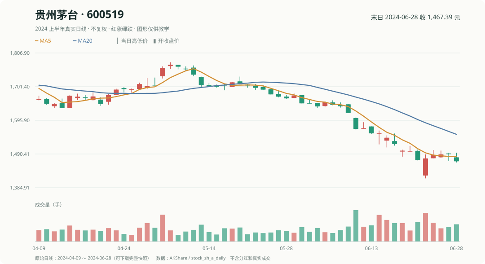
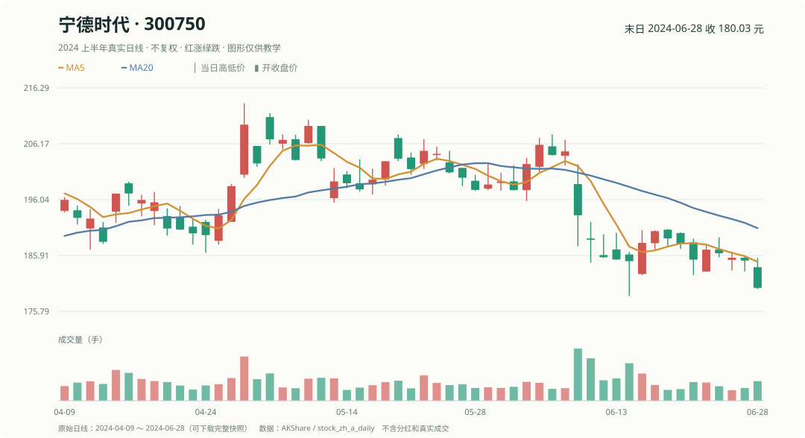

# 第 3 章｜一根 K 线怎样变成一行数据？

在行情软件里看盘，你一眼就能认出阳线、阴线和上下影线。可电脑看不懂“图形”，量化研究的第一步也不是写高深算法，而是**把一根 K 线拆成四个干脆利落的数字，规规矩矩装进表格里**。

## 1. 一根日 K 线，拆开就是四个价格

拿 **贵州茅台 2024 年 6 月 28 日** 这一根真实日 K 线来拆解：

| 开盘（open） | 最高（high） | 最低（low） | 收盘（close） |
|---:|---:|---:|---:|
| **1480.00** | **1494.49** | **1464.00** | **1467.39** |

- **开盘价（open）**：当天集合竞价定下来的第一笔成交价；
- **最高价（high）、最低价（low）**：全天盘中摸到过的天花板和地板；
- **收盘价（close）**：当天收尾定格的价格。

顺手算一下：茅台这一天收盘比开盘低了 **12.61 元**（`1467.39 − 1480.00`）。注意，这只是**6 月 28 日当天的日内涨跌**，并不是“6 月 24 日买、6 月 28 日卖”的那笔五日收益——因为两者的买入日期和价格完全不同。

同样地，宁德时代 **6 月 28 日** 的日 K 线也是一行四个数：

| 开盘 | 最高 | 最低 | 收盘 |
|---:|---:|---:|---:|
| 183.80 | 185.48 | 179.84 | 180.03 |

## 2. 价格表为什么需要股票代码和日期？

只说“宁德时代价格 183 元”，电脑根本不知道你在说哪一天的哪一个价。把宁德时代这三笔真实价格写进同一张表，一眼就明白了：

| 股票 | 日期 | 价格类型 | 价格（元） |
|---|---|---|---:|
| 宁德时代 | 2024-06-21 | 收盘 | 185.16 |
| 宁德时代 | 2024-06-24 | 开盘 | 183.00 |
| 宁德时代 | 2024-06-28 | 收盘 | 180.03 |

想算“6 月 24 日开盘买、6 月 28 日收盘卖”这笔区间价格收益，就必须精准揪出对应的两行：

~~~formula
区间价格收益 = 180.03 ÷ 183.00 − 1 ≈ -1.62%
~~~

如果手一滑把起点拿成了 6 月 21 日收盘价 185.16，算出来的就是另一段完全不同的时间窗口，回答的早已不是同一个交易问题。

## 3. 电脑里的日线行情表长什么样？

落到数据表里，**每只股票的每一个交易日占一行**，最核心的六列长这样：

~~~text
股票代码 | 日期       | 开盘    | 最高    | 最低    | 收盘
300750  | 2024-06-28 | 183.80  | 185.48  | 179.84  | 180.03
~~~

实用表格里通常还会顺手带上**成交量**（成交了多少股或多少手）、**成交额**（一共成交了多少钱）和**换手率**。股票代码负责锁定“哪家公司”，日期负责把走势按先后排成队，四个价格列告诉程序该挑哪个时点的价。

## 4. 不复权价格和你的真实收益，为什么会差出一截？

细心的读者可能在行情软件里见过“不复权 / 前复权 / 后复权”三个按钮。本书使用的**不复权**价格，是指当年盘面上真实挂出的原始报价，没有因为后来的分红、送转股去回头修改历史价格。

为什么这很重要？举个极简例子：一只 10 元的股票，每股派发现金红利 1 元，除息后股价自然落到 9 元。只看 K 线价格好像跌了 10%，可你兜里还实打实多了 1 元现金——**总财富其实一分没少**。

本书先用不复权日线把基础算术练扎实；以后做跨分红、送转日的完整持有收益研究时，一定要把现金分红和送转股统一算进来。

小练习：算“6 月 24 日开盘买、6 月 28 日收盘卖”的收益，为什么不能拿 6 月 28 日的开盘价 183.80 去算？

因为你是 **6 月 24 日开盘**进场的，当时对应的真实报价是 **183.00 元**；6 月 28 日开盘价是四天后的另一笔价格。交易时点和价格列一一对齐，算出来的收益率才有意义。

表格看懂了，下一章我们就动手把走势翻译成数字——算出第一个真正的量化特征。至于“站在某一天时，表里哪些行能用、哪些行不能用”，等我们把指标和财报都认全后，会在第 7 章集中拆解。
