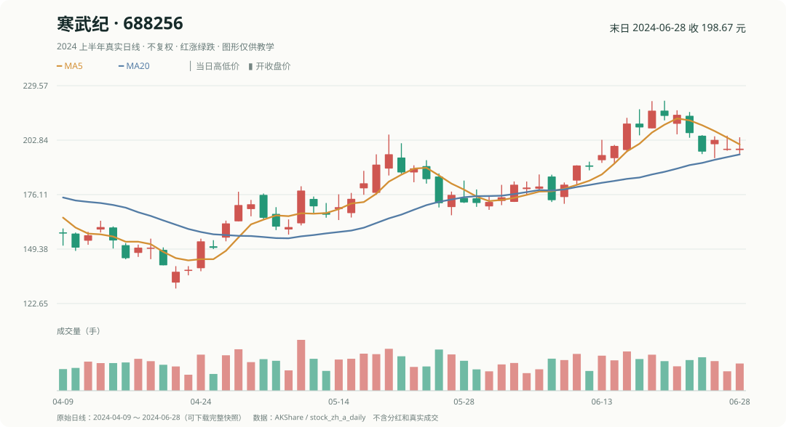

# 第 4 章｜K 线看着不一样，怎样变成一个数字？

平时看盘，我们习惯用感觉描述行情：“寒武纪这几天势头真猛”“茅台最近走得有点弱”。人听得懂这种形容，可电脑不懂什么叫“挺猛”——它只认得算得出来、能排大小的数字。

## 1. 过去五日涨幅，就是你的第一个量化特征

把截至 **2024 年 6 月 21 日**的五个交易日走势，逐一翻译成涨幅数字：

| 股票 | 五个交易日前收盘 | 本日收盘 | 过去五日涨跌幅 |
|---|---:|---:|---:|
| 寒武纪 | 200.01 | 215.29 | **+7.64%** |
| 宁德时代 | 184.89 | 185.16 | **+0.15%** |
| 比亚迪 | 253.05 | 250.67 | **-0.94%** |
| 贵州茅台 | 1555.00 | 1471.00 | **-5.40%** |

这个在选股决策时已经可以算出、用来刻画股票状态的数值，就叫**特征**；拿它来给股票打分排队，就叫**动量因子**——别被“动量”两个字唬住，它不是物理课里的公式，在这里就单指**股票过去一段时间涨得多还是涨得少**。刚才那句模糊的“寒武纪最近涨得猛”，现在变成了一个谁算都一样的精确数字：`+7.64%`。

## 2. 涨幅、成交量、成交额、换手率：四个词别混着说

除了价格涨跌，行情表里还有三个最常用的量能数字，含义各不相同：

- **涨幅**：比较两个时点的价格变化，写成百分比，方便把高价股（茅台）和低价股放在一起比。
- **成交量**：当天一共成交了多少股或多少手——写代码前一定要先看清单位是“股”还是“手”（A 股 1 手 = 100 股）。
- **成交额**：这些成交背后真金白银的总金额（它是每一笔成交价乘以成交股数的总和，并不等于“成交量 × 收盘价”）。
- **换手率**：一段时间内成交的股数，占对应流通股本的百分比。比如某股流通股本 1 亿股，今天成交 100 万股，换手率就约 **1%**。

看一个真实数字：6 月 21 日寒武纪日线记录的成交量约 **65,981.57 手**。光盯这一个数字看不出冷热——只有拿它和寒武纪自己前几天的量、以及同期其他股票的量对比，才能判断当天是不是放量异动。

## 3. 同样的五日涨幅，背后的“心跳”可能截然不同

想象两只股票五天都涨了 5%：一只每天稳稳涨 1%，另一只先连跌两天 −8%、最后三天暴力反抽拉回 +5%。两者的五日涨幅一模一样，持仓体验和风险却天差地别。

正因如此，量化研究不会只盯单一涨幅，还会顺手把**近几日价格波动幅度**、**成交量放大倍数**等线索也翻译成特征。一开始不用急着背复杂公式，每次动笔前先问自己一句：**“我想用哪一个具体数字，去抓住盘面上哪一种现象？”**

小练习：寒武纪从 200.01 元涨到 215.29 元，收益率怎么算？

`215.29 ÷ 200.01 − 1 ≈` **+7.64%**。最常见的新手手误是忘了减 `1`，算出 `1.0764`——那是价格倍数（现在的价格是原来的 1.0764 倍），千万别误读成涨了 107.64%。

下一章，我们把最常用的均线、滚动计算和横向排名拆开算清楚，看看电脑怎样批量加工这些特征。
