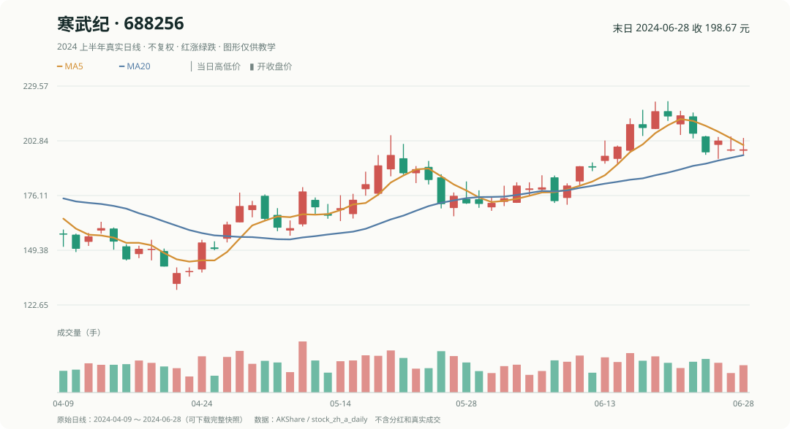

# 第 4 章｜K 线看着不一样，怎样变成一个数字？

你在看盘时可能会说：“寒武纪最近涨得挺猛”“茅台这周比较弱”。电脑听不懂这种形容，需要一个明确计算。

## 1. 过去涨幅，就是最简单的特征

以 2024 年 6 月 21 日为止的五个交易日为例：

| 股票 | 五个交易日前的收盘 | 本日收盘 | 五日涨跌幅 |
|---|---:|---:|---:|
| 寒武纪 | 200.01 | 215.29 | +7.64% |
| 宁德时代 | 184.89 | 185.16 | +0.15% |
| 比亚迪 | 253.05 | 250.67 | -0.94% |
| 贵州茅台 | 1555.00 | 1471.00 | -5.40% |

这个“过去五个交易日涨幅”就是一个**特征**：做选股决定时可以拿到、用于描述股票的数字。用它给股票打分，也可以称为**动量因子**——“动量”在这里就是**过去一段时间涨得多还是少**，不是物理课里的动量。所有分数都来自决策前的价格，因此可以先计算，再排名。

## 2. 涨幅、成交量、成交额不一样

- **涨幅**比较两段价格，可以转成百分比。
- **成交量**表示交易了多少股或多少手；记录单位必须明确。
- **成交额**表示这些成交涉及的资金金额；不是成交量乘以当天收盘价那么简单。
- **换手率**大致是“这一段时间成交的股数，占相应可交易股份的百分比”。例如一天成交 100 万股，按相同口径统计的流通股本是 1 亿股，换手率约 **1%**。计算时必须用对应的股本口径。

例如 6 月 21 日寒武纪日线记录的成交量约 **65,981.57 手**。这个数字只告诉我们交易规模，不表示下一周会涨。

## 3. 同样涨幅，不代表价格路径相同

一只股票可能缓慢爬升，另一只可能先暴跌再反弹；两只五日总涨幅一样，但投资者经历不同。因此还可以计算**近几日价格波动**，或将成交量变化作为另一个特征。

不必第一天就背标准差公式。先问清：“我们想用哪个数字描述过去的哪一段行情？”再动手。

练习：如果寒武纪 200.01 元涨到 215.29 元，收益率怎么算？

215.29 ÷ 200.01 − 1 ≈ **+7.64%**。如果误写成 215.29 ÷ 200.01 而没减 1，就会得到 1.0764（一个价格倍数），不是涨幅 107.64%。

下一章学均线、滚动计算和横向排名；它们都是把行情变成特征的工具。