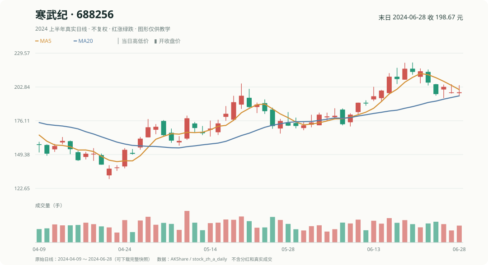

# 第 5 章｜MA5、五日涨幅和股票排名怎样算？

“最近五日”只有四个字，但电脑需要知道：**沿哪只股票、按哪些交易日、取哪种价格**。这里的 **MA5** 就是“最近 5 个收盘价的平均”，**MOM5** 就是“相隔 5 个交易日的两个收盘价之间涨跌了百分之几”。

## 1. 用真实寒武纪计算 MA5

2024 年 6 月 21 日，寒武纪最近五个收盘价的平均为 **213.486 元**，当天收盘价是 **215.29 元**。均线的意思就是：

~~~text
MA5 = 这只股票最近五个已完成交易日的收盘价之和 ÷ 5
~~~

这里的 MA5 与 **五日涨幅**不是同一回事。五日涨幅要比较 6 月 14 日收盘 **200.01 元**与 6 月 21 日收盘 **215.29 元**：

~~~text
MOM5 = 215.29 ÷ 200.01 − 1 ≈ +7.64%
~~~

从 6 月 14 日到 6 月 21 日跨过五个交易日间隔，因此用到了六个日期的端点；MA5 仅取最近五个收盘价。

## 2. 为什么不能把两只股票的行接起来计算？

假设某张表按日期排好，每天依次写寒武纪、宁德时代、比亚迪、茅台。电脑简单地“向上找五行”，可能找到**另一只股票**的价格，算出一个看似正常、实际毫无意义的涨幅。

正确做法：先按股票代码分组，在该股票自己的时间序列上寻找历史价格，再对齐交易所交易日。这类“取前值、求均值、比较大小”的小操作统称**算子**。你可以把算子当成**数据计算的小工具**：输入股票历史价格，按一条明确规则输出结果。

## 3. 还有一个方向：同一天横向排名

2024 年 6 月 21 日四只股票按 MOM5 从高到低是：

1. 寒武纪 +7.64%
2. 宁德时代 +0.15%
3. 比亚迪 -0.94%
4. 贵州茅台 -5.40%

这是在**同一天比较不同股票**，而不是寒武纪自己和昨天比较。

小练习：如果想算宁德时代 MA5，应该拿茅台的价格一起平均吗？

不应该。均线始终沿宁德时代自己的历史价格计算。6 月 21 日宁德时代的 MA5 为 **188.138 元**，与当天收盘 185.16 元不同。

下一章再认识 PE、EP、ROE。它们不是从日 K 线直接算出来的，因此不能拿收盘价去冒充财务利润。