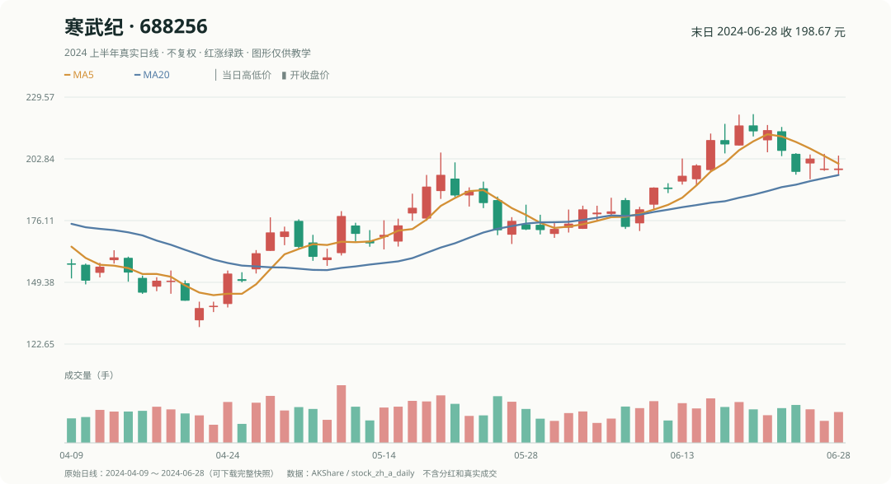

# 第 5 章｜MA5、五日涨幅和股票排名怎样算？

看盘软件里“最近五日”四个字听起来理所当然，但交给电脑算，必须把三个细节交代得清清楚楚：**算哪只股票、取哪几个交易日、用开盘还是收盘**。

这一章先把两个高频缩写拆明白：**MA5** 是“最近 5 个交易日收盘价的平均值”，**MOM5** 是“相隔 5 个交易日的两个收盘价之间涨跌了百分之几”。

## 1. 拿寒武纪亲手算一次 MA5 和 MOM5

2024 年 6 月 21 日，寒武纪当天收盘 **215.29 元**，而它最近五个交易日收盘价的平均数（5 日均线）是 **213.486 元**：

~~~formula
MA5 = 这只股票最近五个已完成交易日的收盘价之和 ÷ 5
~~~

再对比同一天的五日涨幅 **MOM5**：它拿 6 月 21 日收盘 **215.29 元** 除以五个交易日前（6 月 14 日）收盘 **200.01 元** 再减 1：

~~~formula
MOM5 = 215.29 ÷ 200.01 − 1 ≈ +7.64%
~~~

发现微妙的区别了吗？**MA5** 用到最近 5 个收盘价，单位是“元”，刻画的是近五天的**平均成本高度**；**MOM5** 跨越 5 个交易日间隔（头尾共涉及 6 个交易日里的首尾两天），单位是“百分比”，刻画的是这五天的**冲刺速度**。

## 2. 写代码最容易踩的坑：把两只股票接在了一起算

假设你把四只股票的历史行情全放进一张大表，按日期排好序，每天下面依次排着寒武纪、宁德时代、比亚迪、贵州茅台。如果你直接让程序“往上数五行找五天前的收盘价”，电脑根本不管股票名字，**一把抓到的可能是另一只股票的价格**——算出来的数字看起来有模有样，实际上全是垃圾！

正确姿势永远是两步走：**先按股票代码分组**，让每只股票只沿着自己的时间线往前翻历史，再严格对齐交易所交易日历。

像“取前 5 期值”“滚动求 5 日均值”“同一天排大小”这类把原始行情加工成指标的标准小动作，在量化里统称为**算子**。别把词想深了，就把算子当成**数据加工厂里的标准化小工具**：塞进历史价格，按死规矩吐出特征数字。

## 3. 两个计算方向：纵向看自己，横向比别人

前面算 MA5 和 MOM5，都是**同一只股票纵向和过去的自己比**；可真正选股时，还需要第二个方向——**在同一天里，把不同股票横向排成队**。

2024 年 6 月 21 日收盘后，四只股票按 MOM5 从高到低排出来的横截面榜单是：

1. 寒武纪：**+7.64%**
2. 宁德时代：**+0.15%**
3. 比亚迪：**-0.94%**
4. 贵州茅台：**-5.40%**

记住这“一纵一横”两个方向：纵向算的是每只股票自己的走势特征，横向比的是今天谁排在谁前面。后面几乎所有多因子模型，都是在这两个方向上来回组合。

小练习：算宁德时代的 MA5 时，可以把同一天茅台的价格混进去求平均吗？

当然不行。MA5 始终是**沿着宁德时代自己的历史收盘价**滚动求平均——6 月 21 日宁德时代的 MA5 是 **188.138 元**，略高于它当天 185.16 元的收盘价。

价格和走势先聊到这里。下一章我们换个视角，打开财务报表认识 PE、EP 和 ROE——它们来自公司经营成绩单，单靠 K 线图是算不出来的。
