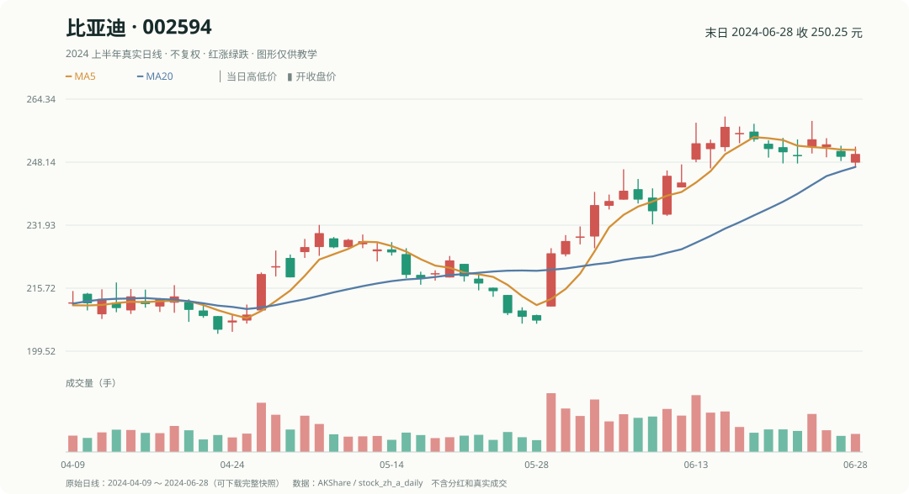

# 第 10 章｜除了过去涨幅，还能同时看均线和成交量吗？

看盘时，很少有人只盯一根指标——你往往会同时瞄一眼近期涨幅、均线位置和成交量。把两个或更多可计算的指标合在一起给股票打分，就叫**多因子**。

但动笔合成之前先记住一句话：**塞进去的指标越多，不等于选股越准。** 我们需要先解决两个实操问题：单位不同的数字怎么拼到一起？两个指标是不是只是在重复说同一件事？

## 1. 同一天的四只股票，先算出第二个指标

回到熟悉的 **2024 年 6 月 21 日收盘后**，把四只股票的五日涨幅、当天收盘价和 5 日均线摆在一张表里：

| 股票 | 过去五日涨幅 | 当天收盘 | MA5 |
|---|---:|---:|---:|
| 寒武纪 | +7.64% | 215.29 | 213.486 |
| 宁德时代 | +0.15% | 185.16 | 188.138 |
| 比亚迪 | -0.94% | 250.67 | 253.804 |
| 贵州茅台 | -5.40% | 1471.00 | 1507.020 |

顺着图找到比亚迪的 MA5，再对照表里的 **250.67 元** 收盘价——收盘略低于 5 日均线。为了把不同价位的股票放到同一尺度下比较，我们构造第二个简单指标——**均线偏离**（看今天的价格比近五天均价高出或低了百分之几）：

~~~formula
均线偏离 = 当天收盘价 ÷ MA5 − 1
~~~

手算两只：寒武纪约 **+0.85%**（站在 5 日线之上），宁德时代约 **-1.58%**（落在 5 日线之下）。正值代表收盘高于 MA5，负值代表低于 MA5。

## 2. 两个指标怎么放到同一张评分表里？

寒武纪的五日涨幅是 **+7.64%**，收盘价是 **215.29 元**，显然不能把 `7.64 + 215.29` 直接相加。最容易上手、也最不怕单位打架的办法是：**先把每个指标各自排成名次分，再加权平均。**

比如每项指标里第一名得 4 分、第二名得 3 分、第三名得 2 分、第四名得 1 分，再给两项指标各分一半**权重**（它在总分里占的比重）：

~~~formula
综合分数 = 0.5 × 五日涨幅排名分
         + 0.5 × 均线偏离排名分
~~~

排名打分的好处是简单抗噪，但也丢掉了一部分信息：**排名只告诉我们谁在前面，没有告诉我们领先了多少。** 寒武纪涨 **7.64%**、宁德时代只涨 **0.15%**，差距悬殊，换成名次分却只是“4 分对 3 分”。

如果既想把不同单位换到同一把尺子上，又想保留“拉开多大差距”的信息，就轮到第 6 章预告过的两位主角登场了。

### 把不同大小的数字换到一把尺子上

还是用这四只股票 6 月 21 日的**真实五日涨幅**，看看两种缩放方法怎么给它们换衣服：

| 股票 | 原来的五日涨幅 | 归一化后（0～1） | 标准化后 |
|---|---:|---:|---:|
| 寒武纪 | +7.64% | **1.00** | **+1.55** |
| 宁德时代 | +0.15% | **0.43** | **-0.05** |
| 比亚迪 | -0.94% | **0.34** | **-0.28** |
| 贵州茅台 | -5.40% | **0.00** | **-1.23** |

先看结果：两种方法**丝毫没有改变四只股票的前后顺序**，但把寒武纪“甩开第二名一大截”的幅度完整留了下来。

**归一化（这里指 Min-Max 缩放）**：把这组数里最小的 **-5.40%** 钉成 **0**，最大的 **+7.64%** 钉成 **1**，其余数字按相对位置落进 0～1 之间。比如宁德时代：

~~~formula
归一化 =（原数值 − 最小值）÷（最大值 − 最小值）
       = [0.15 − (-5.40)] ÷ [7.64 − (-5.40)]
       ≈ 0.43
~~~

**标准化（这里指 Z-score）**：不再盯首尾极值，而是问“这只股票距离这组股票的**平均涨幅**隔着几个标准差”。这四只股票平均涨幅约 **+0.36%**、**标准差**（衡量这组数有多分散的尺子）约 **4.69 个百分点**。算一下寒武纪：

~~~formula
标准化 =（原数值 − 平均值）÷ 标准差
       = (7.64 − 0.36) ÷ 4.69
       ≈ +1.55（寒武纪）
~~~

看准读法：**+1.55** 表示寒武纪比四股平均涨幅高出约 **1.55 个标准差**，绝不是“涨了 155%”。两种尺子都对极端异常值敏感，也都只是“换尺子”，**绝不会自动把一个没用的指标变成好因子**。

小练习：归一化之后茅台的分数是 0，是不是说明茅台一文不值？

当然不是。这里的 **0 只代表茅台在这四只股票当天的五日涨幅里垫底**（-5.40%），和公司好不好、未来涨不涨毫无关系。只要换一批对比股票，它的归一化分数就会跟着变。

### 从截面打分到 TopK 选股

在同一天里把几只股票摊在一张表上横向比较，叫**横截面（cross-section）**。回到 6 月 21 日收盘数据，把五日涨幅排名分和均线偏离排名分各占一半合成总分：

| 股票 | 五日涨幅排名分 | 均线偏离排名分 | 综合分 |
|---|---:|---:|---:|
| 寒武纪 | 4 | 4 | **4.0** |
| 宁德时代 | 3 | 2 | **2.5** |
| 比亚迪 | 2 | 3 | **2.5** |
| 贵州茅台 | 1 | 1 | **1.0** |

**TopK** 就是按综合分从高到低挑出前 \(K\) 只股票。如果选 Top2，寒武纪稳进，第二个名额立刻碰上**并列（都是 2.5 分）**！怎么破局？必须**事先写死并列规则**——比如约定同分按六位股票代码升序，那就选中比亚迪（`002594`）而非宁德时代（`300750`），绝不能等下周谁涨得好再事后挑。

顺便记清一件事：\(K\) 决定“买几只股票”，不自动等于每只分多少钱（假设 100 万元等权买两只，每只目标 50 万元）。这里只演练打分合成步骤，尚未检验盈利能力，也未剔除茅台 6 月 19 日除息带来的原始价差（第二卷第 07–12 章会系统展开截面标准化、排序学习与仓位配置）。

## 3. 当心指标只是在“重复投票”

回头再看一眼上面的表：五日涨得最猛的寒武纪，均线偏离也排第一；五日跌得最深的茅台，均线偏离也排最后。这很正常——**短期大涨的股票，本来就大概率站在 5 日均线之上**。

把两个高度雷同的指标拼在一起，表面上用了“多因子”，实际上可能只是让同一个走势线索投了两票，并没有带来新信息。想知道两个指标是真互补还是重复投票，可以先看它们在多期里的排名是不是老重合，再按第 7 章的方法对比单指标与组合指标的历史表现。

快速判断：把“成交量”直接加上“涨幅百分比”，算更高级的多因子模型吗？

不算，只是把单位完全不同的数字硬凑到了一起，数量级大的成交量会把涨幅彻底淹没。必须先统一到同口径排名或标准化尺子，再检验它们有没有互补价值。

这一章的权重（0.5 和 0.5）是我们拍脑袋给的。下一章，我们迈入机器学习的大门：看看电脑怎么从历史数据里自己学出一套权重。
