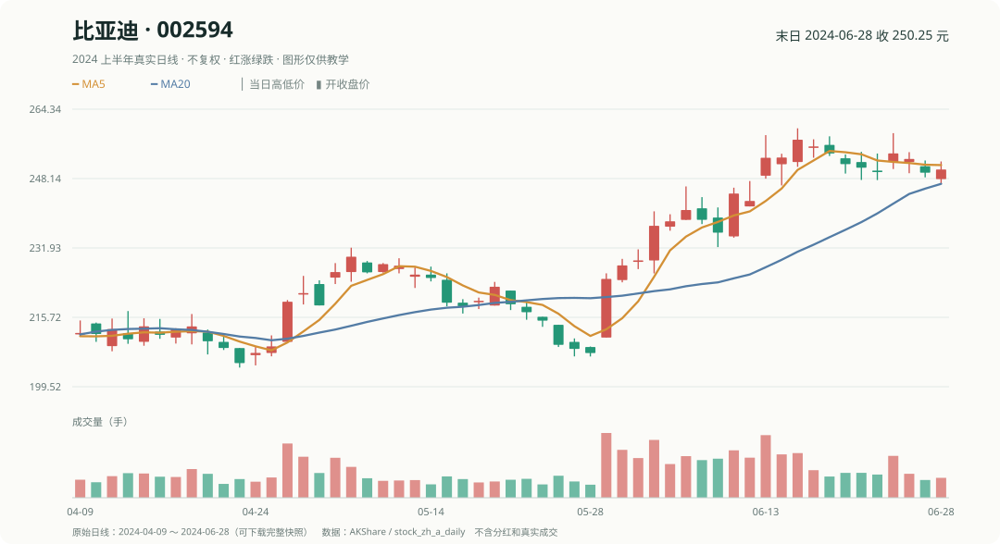

# 第 10 章｜除了过去涨幅，还能同时看均线和成交量吗？

你可能同时看 K 线、均线和成交量。**多因子**就是同时使用两个或更多可计算的股票指标来打分，例如五日涨幅和均线偏离；但**指标越多，不等于选股越好**。先看看它们是否真在提供不同信息。

## 1. 同一天的四只股票，可以算出哪些指标？

观察时点还是 **2024 年 6 月 21 日收盘后**：

| 股票 | 过去五日涨幅 | 当天收盘 | MA5 |
|---|---:|---:|---:|
| 寒武纪 | +7.64% | 215.29 | 213.486 |
| 宁德时代 | +0.15% | 185.16 | 188.138 |
| 比亚迪 | -0.94% | 250.67 | 253.804 |
| 贵州茅台 | -5.40% | 1471.00 | 1507.020 |

你可以在图上先找出比亚迪的 MA5，再对照表中的 **250.67 元收盘价**。图只是帮助你读懂这些数字，不意味着某个均线位置就保证盈利。

一种简单的第二个指标是**均线偏离**：衡量“今天的价格比最近五天平均价格高出或低了百分之几”，不同股价的股票也可以按百分比比较。

~~~text
均线偏离 = 当天收盘价 ÷ MA5 − 1
~~~

例如寒武纪约为 **+0.85%**；宁德时代约为 **-1.58%**。这就是一个新指标：**偏离率为正说明收盘价高于 MA5，为负说明低于 MA5**。

## 2. 为什么不能把原值直接相加？

五日涨幅是百分比，成交量是“手”，MA5 是元/股。**214 元 + 7.64%**并不是一条有意义的统一股票评分。

初学时最容易检查的办法：先在四只股票内分别排名，让每项因子都得到 1、2、3、4 名，再按事先固定的**权重**（也就是每个指标在总分里占多大比重）合成。例如：

~~~text
综合名次分数 = 0.5 × 五日动量名次分数
             + 0.5 × 均线偏离名次分数
~~~

这里的两个 **0.5 是事先设定的课堂演示权重，不是训练发现的最佳权重**。

## 3. 指标有可能只是在重复投票

五日涨得很猛的股票，常常也高于近五日均线。把两个高度类似的指标平均，可能只是“同一个走势线索投了两票”，并不带来真正新信息。

判断两个指标是否互补，可以先观察四只股票在两项指标下的排名是否经常相近；随后再按照第 7 章的方法，比较单一指标和组合指标在不同历史时期的表现。

判断：把成交量直接和涨幅百分比相加，是更复杂的模型吗？

不一定，只是把单位不相同的数字拼在一起，结果可能被数量级大的列主导。先定义同口径排名或合理标准化，再研究它们是否互相补充。

下一章开始介绍最简单的机器学习：让模型从历史记录中学习每个指标的权重。