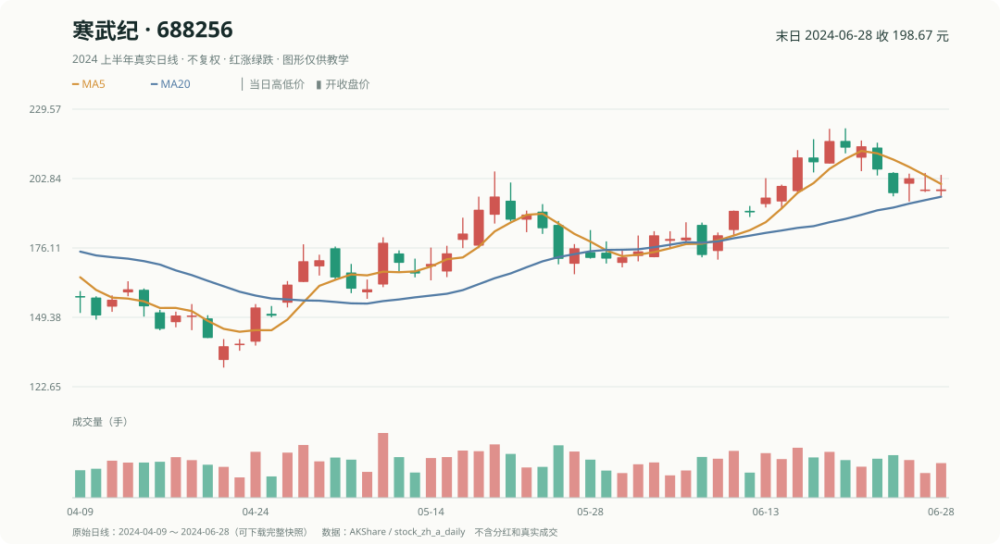

# 第 15 章｜一张 K 线图，怎么变成别人也能复查的研究？

你昨天算出寒武纪后面五天跌了约 7.51%，今天重新打开软件，却发现图上出现了复权价格。哪个数字该相信？

问题不一定在谁算错，而是**你和别人没有说明用的价格口径**。“口径”就是**这个数字按什么规则算、包含什么、不包含什么**。例如“不复权收盘价”和“把分红影响计入后的收益”回答的并不是完全相同的问题。

## 1. 一项研究至少要写清五件事

以本书固定的四只真实股票为例：

| 要记录的事 | 本次具体约定 |
|---|---|
| 股票范围 | 贵州茅台、寒武纪、宁德时代、比亚迪 |
| 决策时间 | 2024 年 6 月 21 日收盘后 |
| 排名依据 | 已形成的过去五个交易日收盘涨跌幅 |
| 计划观察期 | 6 月 24 日开盘至 6 月 28 日收盘 |
| 价格口径 | 不复权日 K 线；未计入股息等权益变化 |

只要这些条件中一个变了，最终收益就可能不同。

## 2. 先复核三个容易错的地方

**第一，选股有没有读未来？** 6 月 21 日的排名只能使用当时及更早的数据。

**第二，有没有把收益和股票价格混淆？** 寒武纪在 6 月 24 日开盘 **214.80**，6 月 28 日收盘 **198.67**，所以未来观察收益约 **-7.51%**；不能拿 6 月 21 日收盘价代替买入价。

**第三，执行有没有假装成交？** 理论资金份额和整股数、现金、手续费结果需要分别标注。

## 3. 把一张图和一张表配起来

图适合看形态，表适合检查精确数字。**最好的研究记录是：别人不需要相信你的结论，也能顺着日期、股票和公式重算一遍。**

练习：把“2024 年 6 月 21 日的寒武纪涨幅”写得更准确

应该写清是“**相对 2024 年 6 月 14 日收盘的五个交易日涨幅 +7.64%**”，还是“2024 年 6 月 21 日**当天**相对前一日收盘的涨幅”。两个问题不能混用。

下一章会让你独立把这套实际数字和研究判断从头复做一次。