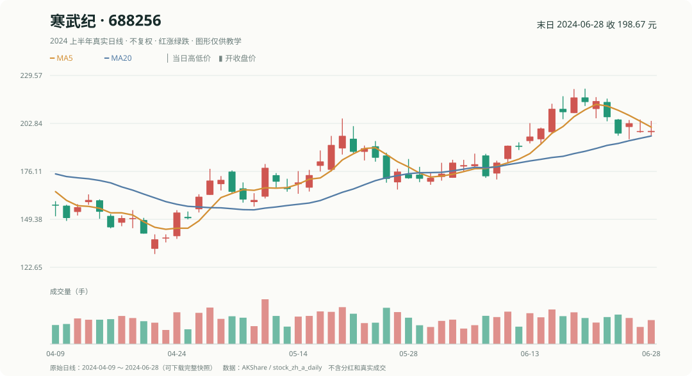

# 第 15 章｜一张 K 线图，怎么变成别人也能复查的研究？

想象一个经常发生的尴尬场景：昨天你算出寒武纪那五天跌了约 7.51%，今天换了个行情软件打开一看，同样日期的涨幅却变成了另一个数——到底谁算错了？

很可能**谁都没算错，只是你们用的价格“口径”不一样**。所谓“口径”，就是**这笔数字按什么规则算出来的、包含了什么、又排除了什么**（比如一个用了不复权收盘价，另一个用了前复权价）。

如果一份研究只留下一张收益截图，不写清口径，一个月后连你自己都复算不出来。

## 1. 一份经得起复查的研究，至少记死五件事

拿全书贯穿的真实四股研究做示范，这五个锚点缺一不可：

| 必须写清的项目 | 本书的具体约定 |
|---|---|
| 股票范围 | 贵州茅台、寒武纪、宁德时代、比亚迪 |
| 决策时间 | 2024 年 6 月 21 日收盘后 |
| 排名依据 | 已走完的过去五个交易日收盘涨跌幅 |
| 观察持有期 | 6 月 24 日开盘至 6 月 28 日收盘 |
| 价格口径 | 不复权日 K 线，未计入现金分红等权益变动 |

只要这五项里悄悄动了任何一项，算出来的收益率就会变脸。把它们白纸黑字钉在报告开头，别人才知道你的数字从哪来。

## 2. 交卷前必查的三个高频易错点

复核自己的计算或看别人发的回测截图时，先顺手戳这三个地方：

1. **日期有没有错位？** 算五日动量用的是 6 月 21 日及以前的收盘价；算持仓收益用的是 6 月 24 日开盘到 6 月 28 日收盘——两段窗口各管各的事，不能串行。
2. **入场价有没有拿错？** 寒武纪 6 月 24 日开盘 **214.80 元**、6 月 28 日收盘 **198.67 元**，对应区间收益约 **-7.51%**；绝不能顺手把 6 月 21 日收盘价当成买入价。
3. **账本有没有把“理想份额”冒充“真实成交”？** 不扣费的理论满仓收益，和按整股数买入、留现金、扣费后的账面金额，必须分开标明。

## 3. 图负责看直觉，表负责对精确数字

K 线图能让你一眼看清走势形态，表格和代码能让你把每一分钱算到小数点后两位。**最好的研究记录，不是靠口才说服别人相信你的结论，而是把日期、代码、口径和公式摊在桌上，让任何人都能自己重算出一模一样的数字。**

小练习：怎么把“2024 年 6 月 21 日寒武纪的涨幅”这句话写得毫无歧义？

必须写明起点与价格类型：是“**相对 2024 年 6 月 14 日收盘的五个交易日涨幅 +7.64%**”，还是“6 月 21 日**当天**相对前一日收盘的单日涨幅”。少写起点，别人十有八九会算成另一个数。

最后一章不讲新概念——把答案盖住，轮到你亲手把这四只真实股票的整套研究从头到尾完整做一遍。
