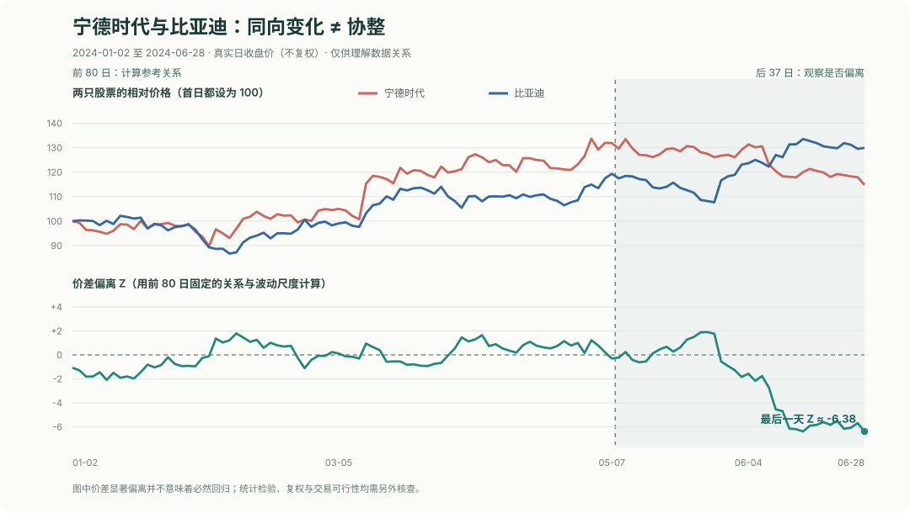

# 进阶专题 A｜从相关性到协整：两只股票一起涨，就能做配对交易吗？

看盘时，你可能发现宁德时代和比亚迪都属于新能源汽车产业链，股价有时也朝同一个方向走。于是会想到：

**如果它们平时走得差不多，某一天突然分开了，是不是可以等它们重新靠近？**

这是研究**配对交易**的一个起点，但不是结论。本专题会依次认识**相关性 → 价差 → 均值回归 → 协整 → 检验 → 交易限制**。第一次读不用安装任何统计软件。

## 1. 先看真实行情：同一行业，不等于关系永远稳定

先看本书已经用过的两只真实 A 股：**宁德时代（300750）和比亚迪（002594）**。

| 交易日 | 宁德时代收盘（元） | 比亚迪收盘（元） | 宁德时代起点=100 | 比亚迪起点=100 |
|---|---:|---:|---:|---:|
| 2024-01-02 | 156.83 | 192.60 | 100.00 | 100.00 |
| 2024-05-07 | 206.88 | 229.88 | 131.91 | 119.36 |
| 2024-06-28 | 180.03 | 250.25 | 114.79 | 129.93 |

**“起点=100”怎么来的？** 例如宁德时代 5 月 7 日的相对价格为：

~~~text
206.88 ÷ 156.83 × 100 ≈ 131.91
~~~

这不是另一个股价，也不是赚了 131.91%；它只是把两只原本价格不同的股票放到**同一个起点**，方便比较走势。

从表格就能看出：5 月初宁德时代相对年初上涨更多，而到 6 月底，比亚迪的相对涨幅反而更高。**两只股票的相对表现发生了变化。**

这让我们产生了一个问题：它们究竟只是偶尔一起涨跌，还是存在某种比较稳定的价格关系？先理解相关性与价差，后面再用完整图表回答。

## 2. 相关性：它们是不是经常同涨同跌？

**相关性**可以先理解为：两组数字是不是经常一起变化。

例如把两只股票每天的**涨跌幅**配对比较，得到一个**相关系数**：

- **接近 +1**：通常同方向变化。
- **接近 0**：没有明显的线性同向或反向关系。
- **接近 -1**：通常反方向变化。

我们只用图中的**前 80 个交易日**，计算其中相邻两天的 79 组日收益率，两只股票的日收益相关系数约为 **+0.615**。这表示那一段时期有一定同向关系。

但请注意：

**相关性高，只说明“它们怎么一起动”；不说明“它们的价格距离会不会回到某个长期水平”。**

你在第 8 章学过的 **RankIC** 也是相关性的一种，但它比较的是**同一天多只股票的两张名次表**。这里比较的是**两只股票跨很多天的涨跌幅**，不是 RankIC。

## 3. 价差与均值回归：为什么不能直接拿两个股价相减？

假设今天宁德时代 180 元、比亚迪 250 元。直接计算 **180 − 250 = -70 元**，看似得到了“价差”，却不合理地假设两只股票应该有**相同的每股价格**。

实际上，一股宁德时代和一股比亚迪没有天然的“一比一”关系。

研究者通常先用一段历史数据估计一条关系：

~~~text
宁德时代价格 ≈ 固定项 + β × 比亚迪价格
~~~

这里的 **β（读作 beta）** 是**配比系数**：表示研究时用多大比例的比亚迪价格去与宁德时代价格对照。它必须从约定好的历史阶段计算，不能看到未来结果后再随意改成最漂亮的数字。

我们用 **2024-01-02 至 05-07 的前 80 日**做一次普通线性拟合，得到：

~~~text
宁德时代参考价格 ≈ -59.44 + 1.169 × 比亚迪价格
价差 S = 宁德时代实际价格 − 参考价格
~~~

这是一条**从真实价格算出的历史拟合关系**，不是说两家公司具有已经得到证明的长期均衡，更不是建议照着 1.169 的比例下单。

如果这个价差长期围绕某个相对稳定的水平波动，偏离后又有返回的倾向，就叫**均值回归**。“均值”是价差的平均水平，“回归”是偏离之后向它靠近的倾向；**不是每次偏离都必须回来**。

## 4. 协整：比“走势相关”多了什么条件？

**协整（Cointegration）** 研究的是：

> 两条价格序列本身可能持续漂移、没有固定平均水平，但它们的**某种线性组合**却能保持平稳。

这里新出现两个词：

- **平稳**：粗略说，一组数在较长时期里围绕相对稳定的统计水平波动，波动特征也没有持续改变。不是指数字每天都一样。
- **非平稳**：例如股价可能从一个价格区间持续走到另一个区间，没有固定不变的平均价格。不能只因走势图向上就断言统计上一定非平稳。

协整分析通常先考虑两条都是**一阶单整 I(1)** 的价格序列：**原始价格不平稳，但每天的价格变化（一阶差分）是平稳的**。如果再存在某种配比，使两者组合后的**价差序列平稳**，才符合典型的协整关系。

所以：

| 观察到的情况 | 能说明什么 | 不能直接说明什么 |
|---|---|---|
| 两只股票经常一起涨跌 | 日收益可能相关 | 一定存在协整 |
| 两张 K 线看起来相似 | 形态可能相似 | 价差一定会回归 |
| 一段历史价差经常上下波动 | 值得进一步检验 | 以后仍会保持这个关系 |
| 统计检验有支持证据 | 在特定假设和样本下支持协整 | 一定存在可执行、可盈利的套利 |

**协整是对数据性质的统计判断；配对交易是根据这种关系尝试执行的策略。两者不能划等号。**

## 5. 怎么判断价差偏离得多不多？认识 Z-score

只有“价差是 -10 元”，还不知道 -10 算不算大。可以拿训练期的历史波动当一把尺子：

~~~text
Z =（今天的价差 − 训练期平均价差）÷ 训练期价差标准差
~~~

**标准差**衡量历史价差通常上下波动多大。**Z-score（标准分数）** 则表示今天的价差大约偏离过去平均水平多少个标准差。

在本书这 80 日的拟合中，训练期价差的标准差约为 **8.33 元**；用**同一把训练期尺子**去衡量 **2024-06-28** 的价差，Z 约为 **-6.38**。

现在你已经知道上图的两个概念了：**相对价格走势**与**价差偏离 Z**。再把整个真实历史过程画出来：

图的上半部分把两只股票的年初价格都设为 100；下半部分使用前 **80 个交易日**确定的价格关系和标准差，观察后 **37 个交易日**的价差偏离。最后一段明显向下，表示 6 月底相对前期参考关系的偏离较大。

这说明**实际价格与前期参考关系相差很远**。然而，Z 很负**不代表“必然反弹”**：也可能是两家公司基本面变化、市场环境改变、价格口径受到公司行为影响，或者短样本本来就估计得不可靠。

尤其本书使用的是**不复权历史价格**。研究协整与持有收益前，必须检查分红、除权、送转等事项，并统一价格口径。

## 6. 怎样做正式的协整检验？（第二遍再读）

常见的入门方法叫 **Engle–Granger 两步检验**。可以先按下面三步理解：

1. **先检查价格性质。** 例如使用 ADF 单位根检验检查两条价格序列是否具有适合典型协整分析的 I(1) 特征。ADF 的“单位根”可以先理解为一种导致序列难以围绕固定统计水平波动的性质。
2. **再估计配比和价差。** 只使用训练期价格确定两个股票的线性关系，得到价差序列。
3. **最后检验有没有协整证据。** Engle–Granger 检验的**原假设是“不存在协整”**。常见的 p 值可以帮助判断数据对这个原假设有多大反对证据；例如预先设定 5% 显著性水平，p 值小于 0.05 时才考虑拒绝原假设，仍然**不是保证关系永不失效**。

这个 p 值也不是“赚钱概率”，更不是“有 95% 概率价差会回归”。

选读｜用 Python 对两只真实股票做一次探索性检查

在项目根目录：

~~~powershell
python examples/cointegration_pair_lab.py
~~~

它直接读取本书保存的宁德时代和比亚迪日线，输出前 80 日的收益相关性、历史价格配比、以及后 37 日的偏离。

如果想进一步运行 ADF 和 Engle–Granger 检验，可以额外安装统计库并执行：

~~~powershell
python -m pip install statsmodels
python examples/cointegration_pair_lab.py --test
~~~

工具返回的统计结果只属于**这两只股票、这段短样本和这些数据假设**。检验前仍需先核查 I(1) 条件和公司行为；不要只看一个 p 值就宣布发现协整。

## 7. 如果真的存在协整，就能立即做配对交易吗？

**还不行。**

典型**配对交易（Pairs Trading）** 尝试对冲两只股票的共同涨跌，只交易它们之间的相对偏离。例如价差偏高时，理论上可能考虑卖出相对偏贵的一边、买入另一边，等待价差缩小。

但“卖出相对贵的一边”有时意味着**先借入并卖出自己并未持有的股票**，这叫**卖空**；在 A 股通常涉及融券资格、可借证券、保证金及当时有效的交易限制。**没有可借券，不可能假装完成两边对冲。** 如果只买其中一边，那是另一种多头策略，不等于完整的多空配对。

即使能做多空，还需要研究：交易费用、融券成本、买卖价差、停牌与涨跌停、交易单位、T+1、配比是否变化，以及价差一直不回归时怎样退出。

我们的课堂账户仍是 **100 万元模拟资金**，但**没有把上面的 Z 当成交易信号，也没有编造一条“协整套利赚了多少钱”的收益曲线**。这份数据只有 117 个共同交易日，样本短，且用知名公司事后挑选的组合；适合学习方法，不足以证明稳定可交易的配对策略。

## 8. 自己试一试

问题一：宁德时代和比亚迪每天涨跌高度相关，就说明协整吗？

**不能。** 相关性主要说明它们短期变化方向有多一致。协整还要求在适当的非平稳序列假设下，存在一个统计上平稳的线性组合。

问题二：2024-06-28 的 Z 约为 -6.38，是不是应该立刻买宁德时代、做空比亚迪？

**不能直接下这个结论。** 这说明价差严重偏离训练期拟合的参考关系。原因可能是关系失效、公司行为、数据口径或真实的暂时偏离，必须继续调查。即使理论上存在机会，融券可得性和成交成本也可能让交易无法执行。

问题三：为什么不能先看完整 117 天，再调整 β，让末尾的偏离看起来很小？

因为那样在 5 月初就已经“知道”了 5–6 月的价格。**先用训练段确定 β 和参考尺度，再用没有参与拟合的日期检查它们是否还能成立**，才符合第 7 章学过的信息时点与时间切分原则。

**本专题最重要的一句话：相关性问“是否一起动”，协整问“是否存在稳定的长期组合关系”，配对交易再问“偏离能不能在真实市场里变成净收益”。**

学完后，建议回看[第 7 章的时间切分](真实_07_时间切分与泄漏.md)和[第 14 章的模型评价与风险](真实_14_评价与风险.md)：真正的统计套利研究，同样不能跳过它们。
