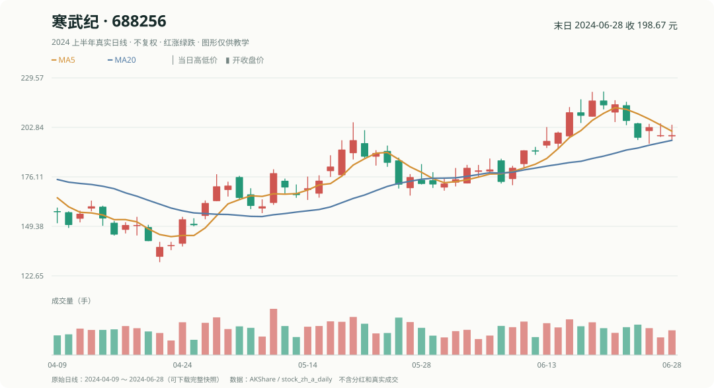

# 起步第一课｜用贵州茅台、寒武纪、宁德时代、比亚迪选一次股票

你在交易软件里看到四只股票。小林问：“如果只按**过去五个交易日涨幅**挑两只，接下来会怎样？”

这一课只用加减乘除。全部价格都来自 2024 年的真实历史日线。

## 1. 决定之前，只能看过去

在 **2024 年 6 月 21 日收盘后**，四只股票已经形成的最近五日涨幅是：

| 股票 | 6 月 14 日收盘 | 6 月 21 日收盘 | 过去五日涨幅 |
|---|---:|---:|---:|
| 寒武纪（688256） | 200.01 | 215.29 | **+7.64%** |
| 宁德时代（300750） | 184.89 | 185.16 | **+0.15%** |
| 比亚迪（002594） | 253.05 | 250.67 | **-0.94%** |
| 贵州茅台（600519） | 1555.00 | 1471.00 | **-5.40%** |

例如寒武纪：**215.29 ÷ 200.01 − 1 ≈ +7.64%**。

我们的规则先固定：**只看这列过去涨幅，选前两名，每只分一半资金。** 所以选中寒武纪和宁德时代。这只是机械选股练习，不是买入建议。

## 2. 未来价格揭晓后，才知道有没有赚

**6 月 21 日不能提前看下面这张表。** 等到约定的观察期结束，才打开：

| 股票 | 6 月 24 日开盘价 | 6 月 28 日收盘价 | 观察到的涨跌幅 |
|---|---:|---:|---:|
| 寒武纪 | 214.80 | 198.67 | **-7.51%** |
| 宁德时代 | 183.00 | 180.03 | **-1.62%** |
| 比亚迪 | 250.00 | 250.25 | **+0.10%** |
| 贵州茅台 | 1423.00 | 1467.39 | **+3.12%** |

寒武纪这笔收益：**198.67 ÷ 214.80 − 1 ≈ -7.51%**。它在过去五天涨得最强，之后五天却跌得最多。这正是量化研究应该允许出现的结果：**规则不是预言。**

## 3. 两只股票的组合如何算？

用课堂资金 **100 万元**，先暂时假设两只股票都能按分配金额精确买入，不考虑手续费和整数股：

- 寒武纪投 50 万元，之后约剩 **462,453.45 元**。
- 宁德时代投 50 万元，之后约剩 **491,885.25 元**。
- 两项合计约 **954,338.69 元**，本次理论毛收益约 **-4.57%**。

以后介绍真正的 A 股交易单位时，会重新计算100股一手买入后的现金余额，这个理论计算**不代表订单真的成交**。

自己试：假如这次四只股票每只分 25 万元，情况会更好还是更差？

四只未来收益分别约 -7.51%、-1.62%、+0.10%、+3.12%，平均约 **-1.48%**。100 万元理论上剩 **985,218.01 元**。虽然仍是亏损，却比选前两名少亏一些。

## 4. 这笔“真实的失败”教了什么

**过去涨得好，下一段不一定还涨。** 真正要研究的是：这种排序方法放到很多事先约好的日期，表现是否稳定？和什么基准比较？考虑买不到、手续费之后还剩多少？

下一课会让 Python 重复同一道题；第一遍不需要记住复杂函数。

[下一课：Python 怎样从真实数据选股票](真实_Python入门.md)