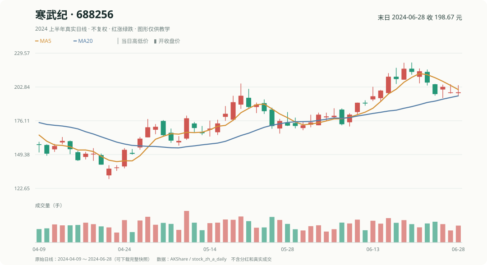

# 阅读指南｜跟着四只真实 A 股学量化

你会看股票行情，但可能没有学过 Python 或统计。我们从**贵州茅台、寒武纪、宁德时代、比亚迪**四只熟悉的股票开始，直接使用 2024 年的真实历史日 K 线。

这本书的学习规则

- 先看价格和图，再用计算器做一道题，最后才给公式与代码。
- 同一段数据分成“当时已经发生的走势”和“后来才知道的收益”。**不能在选股时偷看未来价格。**
- 我们只使用四只事先挑出来的知名股票，便于理解，不代表它们构成公允的全市场股票池。
- 所有价格使用不复权日线。只做课堂演算，不把纸面回测当成真实投资收益。

## 先认识我们的四位主角

| 股票 | 代码 | 学什么 |
|---|---|---|
| 贵州茅台 | 600519 | 贵价股、开高低收、股价与涨跌幅的区别 |
| 寒武纪 | 688256 | 波动、动量、买入后也可能亏损 |
| 宁德时代 | 300750 | 均线、成交量、选股和现金分配 |
| 比亚迪 | 002594 | 排名、基准、验证与比较 |

这张图来自真实历史行情。你需要先知道：一根 K 线代表一个交易日，图上的 MA5 是最近五个收盘价的平均值。

## 一个贯穿全书的日期

我们站在 **2024 年 6 月 21 日收盘后**做决定，只能使用当天以及更早的数据；假设在 **6 月 24 日开盘**买入，并观察至 **6 月 28 日收盘**。这样有真实的过去和真实的未来，但学习时必须先把两者分开。

为了让买一手茅台或寒武纪在数学上有可能，我们用 **100 万元课堂虚拟资金**，不再用只能买几股的 8,000 元。最初为了看懂收益率，允许假设投入资金恰好分成两半；讲到交易时，再处理 100 股交易单位和剩余现金。

## 建议读法

先做起步课，学会用真实价格计算；接着看一次简单 Python 演算。第 1–2 章学基准与复利，第 3–6 章学数据、K 线、特征和因子，第 7–8 章学切分与评价，第 9–10 章学真实交易约束与多因子，第 11–14 章看模型为什么可能失败，第 15–16 章做可复查报告。

**第一次只看每章前面的例子，章末选读可以跳过。** 技术工具和历史研究数据保留在仓库，不需要在开头就研究它们。

读完这一页，先打开[起步：真实四股选股](真实_起步一课.md)。